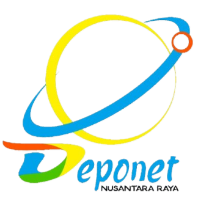

# eponet

A playful, tech‑media‑oriented web application built with **Laravel 12** and **Filament v3**.



---

## About

**eponet** is a full‑stack Laravel application featuring:

- **Filament v3 admin panel** — dashboard, resources, widgets, and exports.
- **Customer, District, Village, Hamlet, and Package management** — complete CRUD with forms, tables, and localization (ID/EN).
- **Import/Export functionality** — Excel/CSV upload with validation, failure‑row handling, and spreadsheet layouts.
- **Brand identity** — custom favicon, color palette (kuning #fbbf24, biru #3b82f6, orange #f97316, hijau #22c55e), and logo assets.

---

## Quick Start

```bash
# 1. Clone
git clone <repository-url> wifi
cd wifi

# 2. Choose your runtime

# ⭐ Option A: Docker / WSL2 (Sail) — rekomendasi untuk team
./vendor/bin/sail up -d --build
./vendor/bin/sail artisan key:generate
./vendor/bin/sail artisan migrate --seed

# ⭐ Option B: Laravel Herd (Windows native, no Docker)
#   lihat SETUP_WINDOWS.md untuk instruksi lengkap

# 3. Access
#   Web:        http://localhost (atau http://wifi.test)
#   Admin:      http://localhost/admin (login via /admin/login)
```

---

## Setup Guides

| Cara | File | Deskripsi |
|------|------|-----------|
| **Sail (Docker / WSL2)** | `SETUP.md` | Instal PHP, MySQL, Mailpit, Vite hot‑reload di container. |
| **Herd (Windows Native)** | `SETUP_WINDOWS.md` | PHP, MySQL, Nginx, Mailpit installer semua‑satu di Windows. |

> **Catatan:** File `.env` sudah disiapkan minimal. Jangan commit `.env` ke repo.

---

## Brand Assets

| Aset | Path | Keterangan |
|------|------|------------|
| **Logo** | `public/logo.png` | Sumber gambar utama (square, white background). |
| **Favicon** | `public/favicon.ico` | ICO multi‑size (16/32/48/64px) dari logo. |
| **Warna utama** | — | Kuning #fbbf24, Biru #3b82f6, Oranye #f97316, Hijau #22c55e. |
| **Fontmark** | `resources/css/app.css` | Custom Tailwind v4 + `custom-colors.css` untuk asekran Filament. |

---

## Project Structure (Penting)

```
wifi/
├── app/Filament/       # Resources, Widgets, Pages
├── app/Models/         # Customer, District, Village, Hamlet, Package
├── database/           # Migrations & Seeders
├── resources/
│   ├── css/app.css     # Tailwind + custom-colors.css
│   └── js/app.js       # Vite entry point
├── public/
│   ├── logo.png        # Brand logo (source)
│   └── favicon.ico     # Generated favicon
├── SETUP.md            # Panduan Sail (WSL2/Docker)
├── SETUP_WINDOWS.md    # Panduan Herd (Windows native)
└── vite.config.js      # Vite + Laravel plugin + Tailwind v4
```

---

## Troubleshooting

| Masalah | Solusi |
|---------|--------|
| **Permission denied (storage, bootstrap/cache)** | `./vendor/bin/sail root-shell -c "chown -R sail:sail storage bootstrap/cache && chmod -R 775 storage bootstrap/cache"` |
| **Vite manifest not found** | `./vendor/bin/sail npm run build` atau `./vendor/bin/sail npm run dev` |
| **Filament exports permission error** | `./vendor/bin/sail root-shell -c "chown -R sail:sail storage/app/private/filament_exports && chmod -R 775 storage/app/private/filament_exports"` |
| **Port 80/3306/5173 sudah dipakai** | Edit `APP_PORT`, `FORWARD_DB_PORT`, `VITE_PORT` di `.env` |

---

## License

This project is open‑source software licensed under the **MIT license**.

---

## Kontak

- **Maintainer:** Tim Wifi Project
- **Stack:** Laravel 12 • Filament 3 • Tailwind CSS 4 • MySQL 8.4 • PHP 8.4
- **Tag:** `v1.0.0`